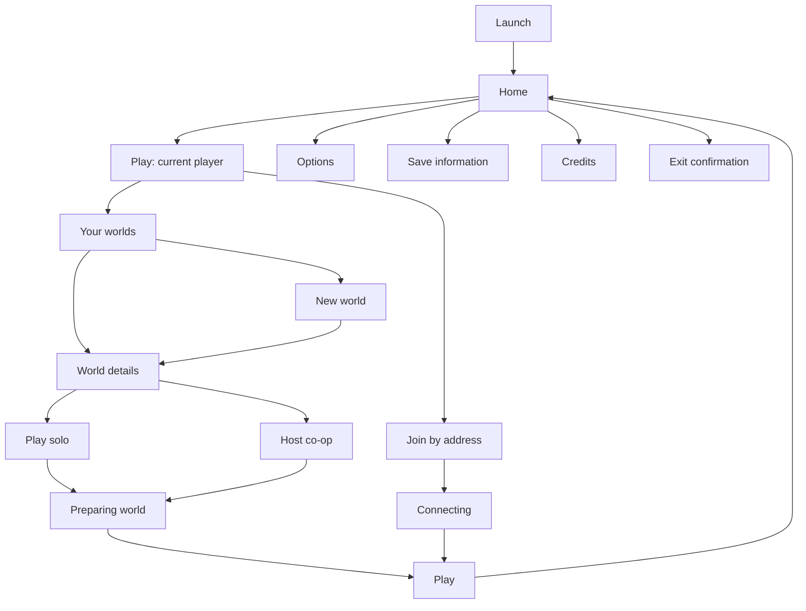

# Start menu research and implementation plan

Planning date: 2026-10-29. Status: implementation contract; SM01 provides a
read-only descriptor, while the front-end flow is not yet active. No gameplay
save-schema changes are part of this plan.

## Valheim reference: evidence and currency

The latest release found on the official news index is **1.0.21, 28 October 2026**.
Its notes explicitly mention main-menu character/world naming fixes, an Xbox
Start Game failure, removal of an Xbox startup controller-association screen,
and a credits overlay repair. Thus older launch videos are not sufficient to
establish current platform-specific startup behavior.
[Official patch 1.0.21](https://www.valheimgame.com/news/patch-1-0-21/).

This is desk research, not an observation of a running retail client. The
following inventory combines official support documentation with Jotunn's
first-hand generated English string inventory, explicitly generated from
**1.0.7**, rather than claiming that inventory is 1.0.21 UI verification.
Strings confirm available concepts, not exact placement, visibility or order.
[Jotunn generated localization](https://valheim-modding.github.io/Jotunn/data/localization/translations/English.html).

### Reference screen inventory

| Branch | Documented controls/concepts | Evidence |
| --- | --- | --- |
| Title | Play entry, settings, credits, exit; changelog/community/feedback utilities | Generated strings; arrangement needs current capture |
| Character | Selection, creation, customization; name, skin, hair and beard choices | Generated strings |
| World | Existing-world selection, creation, name and seed | Generated strings |
| Hosting | Server toggle, community visibility, password and crossplay | Strings and official server guide |
| Joining | Friends, favorites, filtering, server addition, address or invite-code entry | Strings; official crossplay FAQ confirms code path |
| Rules | World-specific modifier screen with presets and individual controls | Official server guide and strings |
| Save management | Character/world categories, backup expansion and restoration, local/cloud movement and storage warnings | Generated strings |
| Transition | Generation, loading, connection and retry/error states | Generated strings |

Structural reconstruction (the arrows express a flow, not verified current
pixel positions): title -> character -> local-world or join branch -> loading
-> play. Creation and save management are side branches. Settings and credits
return to their caller. Invites still require character selection. Startup
splash/account/permission prompts depend on platform and cannot be assumed to
appear every time. Current exact settings tab order, every slider, splash order,
background composition and controller focus require a 1.0.21 retail capture;
they are not established by this research.

Valheim separates selecting who plays from selecting where they play. Its
hosting backend also matters: the official guide distinguishes Steam networking
and crossplay, public listing and private address access. The FAQ documents
Join Game -> Add server for a shared code, obtained by the host in the pause
menu. These are reference capabilities, not Kalmala service commitments.
[Official crossplay FAQ](https://www.valheimgame.com/support/crossplay-faq/),
[Official server guide](https://www.valheimgame.com/support/a-guide-to-dedicated-servers/).

The official guide lists seven rule presets and controls for combat, death,
resources, raids and portals, plus world toggles. The useful design lesson is
that host-owned rules belong with world configuration, separate from personal
presentation settings. Kalmala must expose only rules it actually implements.
[Official server guide](https://www.valheimgame.com/support/a-guide-to-dedicated-servers/).

### What the reference accomplishes

- A short primary path coexists with deeper configuration branches.
- Separate world and character records explain independent save operations.
- World ownership determines whether the player configures rules or joins them.
- Empty lists lead to creation, while populated lists support repeat sessions.
- Destructive operations and storage failures receive dedicated interaction states.

Kalmala should adopt this information architecture using its own wording,
artwork and existing theme. Do not copy reference assets, layout measurements,
ornamentation, lore, audio, source or customization designs.

## Kalmala baseline and boundaries

Read alongside [brief](00-project-brief.md), [design](01-game-design.md),
[architecture](02-technical-architecture.md), [roadmap](04-roadmap.md),
[decisions](05-decision-log.md) and [verification](07-development-setup.md).

Current source facts inspected for this plan:

- `Config/DefaultEngine.ini` boots `L_Prototype` with `KalmalaGameMode`.
  A dedicated pre-game front end is therefore new work, not a renamed title panel.
- `UKalmalaSettingsWidget::ShowMainMenu` currently offers Options and Quit.
  Options already has Controls, Controller, Graphics, Audio and Accessibility.
  Reuse its option presenters, preference storage, focus and theme behavior.
- Gameplay save slots derive from seed, revision and/or authenticated owner.
  `KalmalaGameMode::GetAuthenticatedPlayerIdentity` resolves the network identity;
  a menu character name cannot replace it or select another player's saved state.
- Windows PC and the existing solo/listen/dedicated 1-4-player model remain the
  target. No matchmaking, account provider, crossplay, cloud storage or paid service
  is selected here. Session UI is not evidence those capabilities already exist.

The initial delivery is a complete front end for the supported session model.
Full Valheim-style independent portable characters, appearance editing, backup
restoration, cloud transfers and difficulty presets are expansion candidates.
They are explicitly outside the implementation queue below because they require
new persistence, content or service contracts. Keep their design branches here;
do not present inert controls as working features. In particular, no new
character-save namespace or arbitrary player identity override is authorized.

## Proposed Kalmala flow

### Home and presentation

Home actions, in order: Play, Options, Save information, Credits, Exit.
Initial focus is Play. Display the build version in a quiet footer. No automatic
network requests, advertising/news feed or mandatory account sign-in on launch.
Existing explicit command-line gameplay/dedicated-server launches bypass Home.
Normal packaged client launches use Home only after the complete path passes
acceptance; editor startup remains a development workflow.

Reuse the existing Kalmala menu palette, textures and typography. Keep a quiet
background based on existing original assets; do not select a new visual identity.
A static background is sufficient initially. No live terrain generation, wildlife,
player pawn or gameplay timers run behind Home. Missing decorative art collapses
without blocking navigation. New art is a separate approved asset task.

Implementation defaults selected for this plan: 32 logical-unit outer safe margin,
48 minimum action height, 8 gap, 420-wide home action column, and a scrollable
content area for long lists. Use the existing DPI/text scaling and contrast settings;
validate 1280x720 and 1920x1080 at default and maximum supported text scale.
Focus must remain visible, including without color. Avoid compulsory animation;
respect the existing reduced-motion preference if available, otherwise use static
transitions. Do not change existing settings ranges or defaults.

### Player step

Play shows the current authenticated player identity as a read-only display label,
with Continue and Back. This occupies the structural role of character selection
without inventing portable character saves. Never print internal authentication
keys. If the existing runtime cannot supply a friendly name, display "Current
player". No name entry, inventory transfer or appearance promise in this delivery.
Unavailable authentication disables affected saved-player restoration with an
explanation; do not manufacture an owner ID to make the screen work.

Future character creation would add a list, original preview, create/edit/remove
and character persistence. It requires its own approved identity and save contract
before implementation; no current child silently enables it.

### Worlds and launch

Your worlds shows supported local records: display name when supplied by existing
metadata, otherwise a seed-based label, seed, generator revision and compatibility
status. Read through existing owners; no recursive arbitrary file browser and no
rewriting saves while enumerating. Sort by existing last-played timestamp descending
when available, then label ascending; missing timestamps sort last. Show an empty
state with New world. Selecting a row never starts it automatically.

World details offers Play solo, Host co-op and Back. Solo creates no advertised
session. Hosting uses the existing listen-server path, capped at four players.
Explain that the session ends when its host exits. Only display password, discovery
or visibility options if an existing backend enforces them end to end; otherwise
show address-based joining with a clear connection explanation. Do not store or
log passwords. Dedicated-server clients use Join; the menu does not spawn an
unmanaged background dedicated-server process.

New world accepts the existing world-seed type and active generator revision.
Default to a fresh valid seed from the existing generator's seed helper; expose
only a numeric seed if that is all the runtime supports. Validate the full range
against the runtime type, disallow trailing garbage and never silently wrap.
No free-form seed hashing or new metadata save file. Duplicate seed/revision
identities select the existing world after confirmation rather than overwrite it.
Do not claim multiple independently named copies of the same seed are supported.
The current runtime has no fresh-seed helper or validated creation lifecycle.
Until lifecycle integration exists, the New world entry accepts an explicit
decimal seed only to check for an exact listed current-revision identity. It
opens the existing read-only details after confirmation; missing or uncertain
matches explain why reuse is unavailable. The seed check does not create or write
a save, and fresh-world creation remains disabled.

World rules initially displays the existing supported configuration read-only.
There are no new difficulty multipliers, free-material building or cheat presets.
Future editable rules need explicit server validation and persistence ownership.

### Joining and failures

Join accepts an address through a structured parser, never a command or raw travel
option string. Initial supported syntax: IPv4 or DNS hostname with optional decimal
port 1-65535 inclusive; omitted port uses the existing configured gameplay port.
Trim outer whitespace; reject internal whitespace, path separators, URL schemes,
travel-option separators and control characters. Maximum input: 253 characters
including port. IPv6 and join codes remain unsupported with an explicit message.
DNS resolution is a connection-stage result, not a synchronous UI operation.

One connection/launch request at a time. Use one monotonically increasing request
token so late callbacks from canceled requests cannot travel or update the screen.
Disable repeated submit immediately. Connecting has Cancel; timeout after 30
seconds returns to Join with address preserved. World generation/loading uses
engine events and elapsed time rather than fake percentages; warn after 60
seconds but do not abort an active save/load mid-write. Back becomes unavailable
once irreversible engine travel begins, with that state explained. Failure returns
to the originating panel; Retry is always an explicit action, never an automatic loop.

Errors distinguish malformed address, unreachable host, full session, incompatible
build, rejected authentication, unsupported/corrupt save and travel failure when
the backend supplies that reason; otherwise show a neutral connection failure.
No guessed diagnosis. Reject incompatible development saves without rewriting or
migrating them. Never mutate a good save to recover from an unsuccessful launch.

### Options, save information, credits and exit

Options is the existing five-tab settings view, accessible before gameplay and
from the existing in-game modal. Keep existing apply/revert behavior and restore
focus to the caller. Refactor the Options/Quit home panel into a reusable options
entry; there must not be two competing Escape handlers or preference stores.

Save information is initially read-only: supported world/player records, identity
match and compatibility/load status. State clearly which gameplay facts persist;
ordinary inventory/equipment restoration must not be promised beyond existing
contracts. No Delete, Rename, Restore or Cloud buttons until their data-owner
operations are separately approved and implemented. Do not expose absolute private
filesystem paths. This deliberate scope differs from Valheim's save manager.

Credits uses existing project attribution only, scrollable with Back; absent credits
content gets a truthful project label rather than invented contributors. Exit opens
a confirmation with Cancel focused. Escape cancels, Enter activates the focused
choice, and affirmative Exit requests the standard engine shutdown.

## Integration and lifecycle

Use a local-player/GameInstance-owned front-end coordinator and a dedicated
non-gameplay menu world or equivalent lightweight startup context. Keep menu state
out of `KalmalaGameMode` gameplay ticks. Reuse CommonUI input ownership and theme.
Gameplay HUD subsystems must explicitly decline creation in the front-end context;
closing a settings panel must not release gameplay input into a menu background.

Adapters expose current world descriptors and existing validated launch paths.
The server derives world identity and validates ownership/configuration as today;
client UI checks are convenience only. Never accept a client's selected save slot,
reward state, owner identity, damage or item data as authority. No gameplay SaveGame
schema changes or migrations. UI selection is memory-only, cleared on process
restart; existing options retain their current restart behavior. No new MRU file.

Returning from play waits for existing logout/save completion, tears down the
session through its owner and returns to Home with gameplay HUD removed. On
shutdown/failure release widgets, delegates, timers and pending request tokens.
Never overwrite unrelated main-checkout changes during implementation handoffs.

## SM01 runtime mapping

`FKalmalaWorldDescriptorAdapter` describes an explicitly supplied
`FKalmalaWorldGenerationConfig`: its full uint64 seed and the current revision
used by `FKalmalaM7SaveIdentity::ForWorld`. That revision is a candidate identity,
not a revision read from a saved record. The adapter reports saved-world existence
and compatibility as unknown, and stored revision, display name, last-played time
and enumeration as unavailable. Unsupported enumeration is not an empty list.
`Describe` reads and writes no save slots and makes no claim that a world exists.

`FKalmalaWorldDescriptorAdapter::InspectKnownSeed` delegates to the read-only
world-save inspector for the fixed world-scoped slots. It reports each component
as accepted, rejected, or absent under its existing identity check. Ocean travel
is checked only for the current generator revision. The inspection loads known
component saves but never writes them; it does not prove a complete or launchable
world and does not change overall saved-world compatibility from unknown.

- **Enumeration and creation:** no project world registry or validated menu
  creation API exists. SM07 uses the platform save-name API when supported and
  recognizes only exact world-scoped slot prefixes. A seed found in those names
  is a candidate with saved components, not proof of a complete or compatible
  world. Independent save owners use different slot identities.
- **Seed and travel:** `AKalmalaWorldGenerationGameState::PostInitializeComponents`
  selects its default or the process `WorldSeed=` on the authority and replicates
  it. There is no project menu travel API or runtime seed selection here.
- **Authentication:** the GameMode's private `GetAuthenticatedPlayerIdentity`
  reads the PlayerState network ID for server save ownership; it is not a friendly
  menu label or a client-selectable identity. Missing identity remains unavailable.
- **Logout and sessions:** `AKalmalaGameMode::Logout` calls server player-state
  persistence before engine logout, but exposes no completion callback. No project
  session creation/teardown adapter or verified four-player enforcement was found.
  Launch, hosting and return remain work for their respective later children.

## SM02 coordinator contract

`UKalmalaMenuFlowSubsystem` owns an initially inactive flow per local player;
it creates no widgets and does not change startup. Explicit activation opens Home.
Navigation is blocked during an attempt. Launch begins only from World details,
and connection only from Join. One nonzero, monotonically increasing token owns
an attempt. Cancel or failure restores its originating screen, and a later attempt
gets a different token. Travel dispatch is a one-shot token-checked callback; the
flow commits before calling it, so duplicate or reentrant dispatch fails. Once
travel starts, cancel is refused. Success requires committed travel, and stale
success/failure callbacks cannot change state. Token exhaustion fails closed;
shutdown invalidates the attempt without resetting the counter.

Later async integrations must capture a weak pointer to the original subsystem,
not a flow reference or a replacement owner. They must dispatch travel through
`TryCommitTravel` and apply callback results through the token-checked completion
methods, never through direct navigation. This scaffold does not initiate travel,
validate world choices, or wire UI; those remain in later children.

## SM03 menu context

`AKalmalaMenuGameMode` is an isolated `AGameModeBase` with the distinct
`AKalmalaMenuPlayerController`, no default or spectator pawn and no HUD class.
Its start, restart and default-spawn paths decline player pawn creation; the
controller declines fallback spectator and default HUD spawning. It does not
run `AKalmalaGameMode` world generation. Gameplay UI, tutorial, ambient audio
and weather owners recognize the menu controller before doing their gameplay
work and release existing presentation and input bindings on entry. Settings
remains available for the shared Options work.

This native context is not yet a startup map or a wired menu. A future dedicated
empty menu world must explicitly select this mode and its controller; normal
startup still uses the prototype gameplay map. SM15 must verify live menu/game
round trips, widget cleanup and recreation, and settings input ownership.

## SM04 Home presentation

The local-player Home owner mounts `UKalmalaHomeWidget` only for the dedicated
menu controller and Home flow state, then requests focus for Play. Its ordered
Play, Options, Save information, Credits and Exit actions emit a local event;
without a listener they report that the option is not available yet. Later
branches must bind each newly mounted widget and report unavailable actions until
implemented. A build-version footer uses `FApp::GetBuildVersion`, with a truthful
empty-value fallback. Theme, text scale, contrast and reduced-motion preferences
come from the existing settings and theme. A 32-unit safe area contains a bounded
420-unit action column with 48-unit minimum rows, 8-unit gaps and a scrollable
region for content overflow. Normal startup is unchanged; no menu world is wired.
Actual viewport focus, measured layout and both resolution/text-scale render
cases remain part of integrated acceptance.

## SM05 shared Options entry

Home's Options action opens the existing `UKalmalaSettingsSubsystem` presenter
and keeps Home collapsed until the presenter closes. The visible Back action
returns a Home caller to its Options button with UI-only input; in gameplay it
returns to the existing in-game shell. Home Options also handles unconsumed
Escape or gamepad Back within the widget. The gameplay Settings input binding
is not installed for the menu controller. Both paths use the same settings
widget and store, including the existing immediate/apply behavior and audio
flush; no new rollback semantics are introduced. If the menu owner disappears,
the close callback is removed and the Options flow is abandoned without focusing
an old controller. Actual focus, control-specific Back handling and round-trip
input ownership require integrated live verification.

## SM06 current-player step

Home Play opens an owner-local, read-only Current player screen. The label is
always generic: the menu does not display player names, network identifiers or
credentials and cannot choose a save owner. It checks only whether the menu
PlayerState has an available ID to explain a missing identity; availability is
not a claim of successful server authentication. Saved-player restoration still
requires the server's existing authenticated ownership checks. Continue exposes
a local event and now opens the world-list entry described below. Back restores
Home and its Play focus.
The pre-game context cannot diagnose a later server authentication rejection;
that connection-stage error remains for SM12.

## SM07 world list and details

Continue from the player step opens a read-only Your worlds screen. It requests
known save names through Unreal's platform save system and recognizes only
`KalmalaPopulationDeltas_<seed>`, `KalmalaConstruction_<seed>`,
`KalmalaStorage_<seed>`, and `KalmalaOceanTravelWorld_<seed>_<revision>`.
Names must contain canonical decimal uint64 seeds; ocean revision text must be
a non-negative int32. Player-scoped and unrelated slots are ignored. If the
platform reports that name enumeration is unsupported, the UI says so. If it
succeeds with no recognized world-scoped slots, the UI reports no recognized
world data and does not imply that worlds without saved changes were disproved.

The screen aggregates known component slot names by seed and sorts seed-based
labels ascending because the existing world saves supply no display name or
last-played timestamp. Selecting an entry opens World details; it never starts
travel. Details show the seed, component slot names, and any generator revision
present in an ocean-travel slot name. Opening details performs read-only checks
of the existing world-scoped component payloads. Each component is labeled
accepted, rejected, or absent under its existing identity rules; ocean travel is
checked against the current revision slot only. These checks do not establish a
complete world or overall compatibility, which remain unknown. Current generator
revision is labeled as current, not as a value read from the save. World rules
are unavailable because no saved-world rules source exists. New world can check
an explicit seed only when save-name enumeration is supported; creation remains
disabled until its validated lifecycle path exists. Back from details returns to
the same selection; Back from the list restores the player step and Continue
focus. Save payloads may be read for component checks, but no save is rewritten.

## Ordered delivery and acceptance

The backlog's SM01-SM15 children implement only the initial delivery described
above. Each run completes the first unchecked unblocked child, splitting further
before implementation if necessary. Runtime boot activation stays last, so partial
screens cannot strand normal players. Source mapping verifies exact adapter APIs
before wiring; it may not invent persistence support.

Normal children use inspection and narrow checks. Final acceptance covers fresh
launch, empty/existing world lists, solo start/return/restart, listen-host plus client
join and disconnect, dedicated join, invalid/full/incompatible connections, cancel
and stale callbacks, failed load without save mutation, keyboard/controller focus,
text scaling, shared settings persistence and absence of gameplay HUD in Home.
Run applicable builds, UI/authority automation and packaged session verification
from `docs/07-development-setup.md` for this integrated feature; record commands,
results and repairs. A standalone menu render is presentation evidence only.
Keep the parent unchecked until required final verification succeeds; no existing
roadmap milestone is reopened or declared complete by this planning change.
